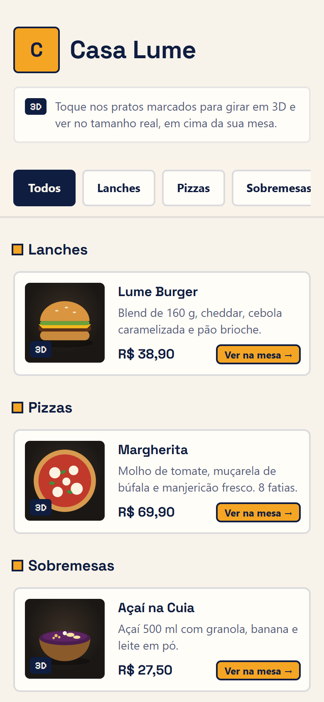
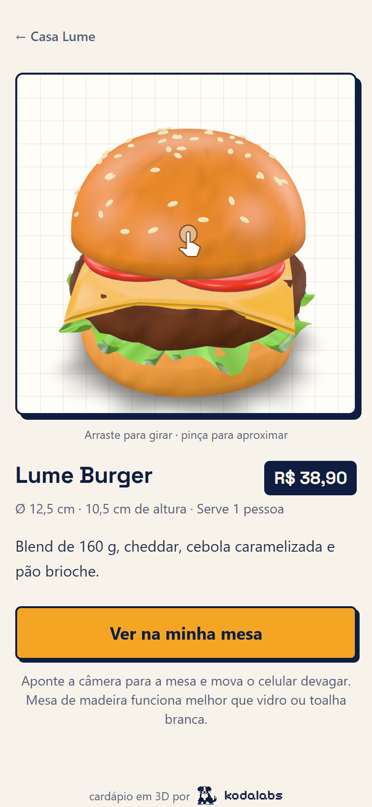

<div align="center">

# 🍔 Cardápio AR

**O cliente vê o prato em 3D e em realidade aumentada, no tamanho real, em cima da própria mesa. Sem instalar app.**

[](https://react.dev)
[](https://www.typescriptlang.org)
[](https://vite.dev)
[](https://tailwindcss.com)
[](https://supabase.com)
[](https://modelviewer.dev)
[](https://pages.cloudflare.com)

Um produto [**KodaLabs**](https://github.com/betiolz7/kodalabs)

<br>


&nbsp;&nbsp;&nbsp;


<sub>Modo demonstração: cardápio "Casa Lume" rodando no celular</sub>

</div>

---

## ✨ Como funciona para o cliente

1. **Escaneia o QR code** da mesa
2. O cardápio do restaurante **abre no navegador**, sem baixar nada
3. **Gira o prato em 3D** com o dedo e vê medidas e porção
4. Toca em **"Ver na minha mesa"**: a câmera abre e o prato aparece **em escala 1:1** em cima da mesa

Funciona no Chrome (Android) e no Safari (iPhone), via WebXR, Scene Viewer e Quick Look.

## 🚀 Funcionalidades

**Para o cliente**
- Cardápio por categorias, com foto, preço, descrição e quantas pessoas cada prato serve
- Visualizador 3D carregado sob demanda e realidade aumentada no tamanho real
- Aviso quando o cardápio é aberto dentro do Instagram ou de outro app onde o AR não funciona

**Painel do restaurante (`/admin`)**
- 🍽️ Cadastro de pratos com foto tirada pelo celular, comprimida no aparelho antes do envio
- 🧊 Envio do modelo 3D com **validação automática**: escala, base na mesa, tamanho do arquivo e medidas conferidas antes de publicar
- ⛔ Marcar prato como esgotado (o garçom também consegue)
- 🗂️ Organizar pratos e categorias
- 🔳 Mesas com **QR code**, download em SVG e impressão das plaquinhas em A4
- 📊 **Métricas**: visitas, pratos abertos, quem girou o 3D, quem viu na mesa, ranking de pratos e visitas por mesa
- 👥 Papéis de acesso: dono, admin e garçom, com isolamento entre restaurantes no banco (RLS)

## 🛠️ Stack

| Camada | Tecnologia |
|---|---|
| Front-end | React 19, TypeScript, Vite, Tailwind CSS 4, React Router |
| 3D e AR | `@google/model-viewer`, three.js, glTF Transform |
| Back-end | Supabase: Postgres, Auth, Row Level Security, Storage e RPCs |
| Hospedagem | Cloudflare Pages (custo zero, uso comercial permitido) |
| Qualidade | Vitest, Playwright (e2e), oxlint e CI no GitHub Actions com Supabase local |

## 💡 Decisões de engenharia

- **Custo zero até ter receita:** SPA estática no Cloudflare Pages + Supabase Free, com uma rotina que impede o projeto de pausar por inatividade
- **Segurança no banco:** cada restaurante só enxerga os próprios dados por RLS, e o app se recusa a iniciar se detectar uma chave secreta no front
- **Modelos leves:** script próprio de otimização (quantização + texturas WEBP) e validador que usa as mesmas regras do painel
- **Modo demonstração:** sem `.env`, o app roda com um cardápio de exemplo, ótimo para mostrar o produto sem backend

> As decisões completas, a análise de mercado e o pipeline dos modelos 3D estão no [`CONTEXT.md`](CONTEXT.md).

---

# 🧑‍💻 Para desenvolvedores

Leia o [CONTEXT.md](CONTEXT.md) antes de mexer no código. Ele explica as decisões, as regras de escala e a restrição de custo zero.

## Rodar

```bash
npm install
npm run dev          # http://localhost:5173
```

Sem o arquivo `.env`, o app roda em **modo demonstração**: o cardápio "Casa Lume" (`/casa-lume`) sai de `src/lib/demo-data.ts`. Serve para mostrar o produto sem backend.

### Com o Supabase local (requer Docker)

```bash
npx supabase start -x studio,imgproxy,mailpit,realtime,edge-runtime,logflare,vector,supavisor,postgres-meta
cp .env.example .env.local      # cole a PUBLISHABLE_KEY mostrada pelo comando acima
npm run dev
```

- `npx supabase db reset` reaplica as migrations e o `supabase/seed.sql`.
- `npx supabase stop` desliga tudo.
- **Nunca** coloque a `SECRET_KEY` ou a `service_role` no `.env`. O app se recusa a iniciar se detectar uma delas.

## Painel do restaurante (`/admin`)

Acesse `/login` com o e-mail e a senha do restaurante. No painel você pode:

- **cadastrar e editar pratos:** nome, categoria (ou uma nova), descrição, preço e quantas pessoas serve;
- **usar a foto:** "Tirar foto" abre a câmera do celular, ou escolha da galeria. A foto é comprimida no aparelho (cerca de 1200 px, WEBP) antes de enviar;
- **enviar o modelo 3D:** o `.glb` exportado do app de escaneamento. O painel lê as medidas do arquivo, sugere as medidas do prato, mostra a prévia em 3D e **bloqueia** modelo em escala errada, com a base fora da mesa, arquivo grande demais ou medidas que não batem com as informadas. O `.usdz` para iPhone é opcional;
- **marcar como esgotado** direto na lista. O garçom (`staff`) só consegue fazer isso;
- **organizar** a ordem dos pratos (setas) e as **categorias** (criar, renomear, reordenar, excluir). Categorias vazias não aparecem no cardápio;
- **mesas e QR codes:** criar mesas numeradas ("+10 mesas") ou com nome, baixar o QR em SVG, gerar um código novo e **imprimir as plaquinhas** (folha A4, 2 por linha, com linha de corte);
- **métricas** (7, 30 ou 90 dias): visitas, pratos abertos, quem girou o 3D, quem viu na mesa (AR), visitas por dia, ranking de pratos, visitas por mesa e aparelhos. Há também um alerta quando muita gente abre pelo Instagram, onde o AR não funciona.

Os arquivos vão para o bucket público `menu` do Supabase Storage, em `{restaurant_id}/{prato}.{carimbo}.{ext}`.

### Criar o acesso de um restaurante

Não existe cadastro público (`enable_signup = false`). Somos nós que criamos a conta, com o script:

```bash
SUPABASE_URL=<url do projeto> SUPABASE_SERVICE_ROLE_KEY=<service_role> \
  node scripts/create-owner.mjs dono@restaurante.com.br <senha> <slug-do-restaurante> [owner|admin|staff]
```

Ele cria o usuário (ou reaproveita, se já existir) e dá o papel no restaurante. A service key fica só no seu computador.

Para fazer manualmente:

1. No painel do Supabase, em **Authentication > Users > Add user**, crie o usuário com e-mail e senha.
2. No **SQL Editor**, rode:

```sql
insert into public.memberships (user_id, restaurant_id, role)
select u.id, r.id, 'owner'
from auth.users u, public.restaurants r
where u.email = 'dono@restaurante.com.br' and r.slug = 'slug-do-restaurante';
```

## Testes

```bash
npm test             # unitários (Vitest)
npm run test:e2e     # ponta a ponta (Playwright), em modo demonstração
npm run check        # lint + build + unitários

# e2e contra o Supabase local, incluindo o painel (cadastro com foto e 3D):
VITE_SUPABASE_URL=http://127.0.0.1:54321 \
VITE_SUPABASE_ANON_KEY=<PUBLISHABLE_KEY> \
SUPABASE_SERVICE_ROLE_KEY=<SERVICE_ROLE_KEY> \
npm run test:e2e
```

O teste do painel cria um usuário temporário com a service key (que só existe no processo do teste e nunca vai para o navegador), cadastra um prato e apaga tudo no final. Sem essas variáveis, o teste é pulado.

## Modelos 3D

```bash
node scripts/optimize-model.mjs prato.glb      # gera prato.otimizado.glb (cerca de metade do tamanho) e valida
npm run check:models
node scripts/check-model.mjs prato.glb --dims diameter=35,h=3 --require-usdz
```

- **`optimize-model.mjs`:** quantização da malha, texturas WEBP de até 2048 px e simplificação leve. Não usa Draco nem Meshopt, que obrigariam o celular a baixar um decodificador de outro site.
- **`check-model.mjs`:** valida a unidade (metros), a base em y = 0, o tamanho do arquivo, as texturas, a presença do USDZ, a compressão e se as medidas batem com o cadastro. Usa as mesmas regras do painel (`src/lib/model-rules.ts`).

O pipeline completo está na seção 6 do CONTEXT.md.

## GitHub Actions

- **`ci.yml`** (push na `main` e PRs): lint, tipos, build, testes unitários, validação dos modelos e e2e em modo demonstração. Um segundo job sobe um Supabase local no runner, aplica as migrations e roda o e2e do painel.
- **`keepalive.yml`** (a cada 3 dias): consulta o cardápio para o Supabase grátis não pausar o projeto. Configure os secrets `SUPABASE_URL`, `SUPABASE_ANON_KEY` (chave **pública**) e `KEEPALIVE_SLUG`. Sem eles, a rotina não faz nada.

## Testar o AR no celular

O AR exige **HTTPS**, então `http://192.168.x.x:5173` não funciona. Use um túnel gratuito, sem conta:

```bash
npm run dev:demo                                      # modo demonstração, mesmo com .env.local
npx cloudflared tunnel --url http://localhost:5173    # mostra uma URL https://....trycloudflare.com
```

Abra `https://....trycloudflare.com/casa-lume` no celular (Chrome no Android, Safari no iPhone) e teste "Ver na minha mesa". Feche o túnel (Ctrl+C) quando terminar.

Use o modo demonstração: o celular não alcança o Supabase local (`127.0.0.1`). Para testar o painel no celular (foto pela câmera, envio do `.glb`), publique o app (seção Deploy). Não abra um túnel para o Supabase local: as chaves locais são públicas e qualquer pessoa com a URL teria acesso total ao banco.

## Deploy (Cloudflare Pages, grátis)

1. Suba o repositório para o GitHub.
2. No Cloudflare, vá em **Workers & Pages > Create > Pages > Connect to Git**.
3. Configure:
   - Build command: `npm run build`
   - Output directory: `dist`
   - Variáveis de ambiente: `VITE_SUPABASE_URL` e `VITE_SUPABASE_ANON_KEY` (a chave pública)
4. Para aplicar as migrations no projeto Supabase de produção: `npx supabase link --project-ref <ref>` e depois `npx supabase db push`.

O arquivo `public/_headers` define o tipo MIME dos `.glb` e `.usdz`, o CORS e o cache. Sem um `404.html`, o Pages já trata o site como SPA, então não é preciso `_redirects`.

## Estrutura

```
src/
  pages/           MenuPage, ItemPage, HomePage
  admin/           painel: login, lista de pratos, cadastro (carregado sob demanda)
  components/ar/   ModelViewer (carregado sob demanda), InAppBrowserNotice
  components/menu/ MenuItemCard, CategoryTabs
  lib/             menu (get_menu + cache), analytics (track_event), rpc, device, format, demo-data
supabase/
  migrations/      schema, RLS, RPCs
  seed.sql         restaurante de demonstração
scripts/           check-model.mjs, optimize-model.mjs, create-owner.mjs
tests/e2e/         Playwright
prototype/         protótipo estático da Fase 0
```

---

<div align="center">

Feito por [Gabriel Betiol](https://github.com/betiolz7) · KodaLabs

</div>
